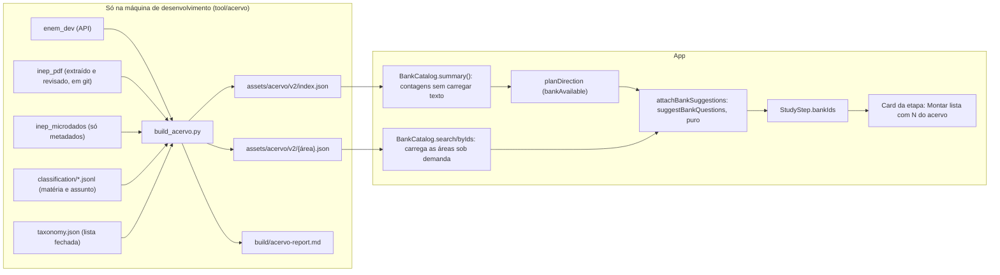

# Banco de questões multifonte para o Direciona

**Situação:** proposta de 26/11/2026, aguardando as decisões DB1 a DB5 do Fred. **Branch sugerida:** `feat/banco-multifonte`, a partir de `main` (v0.2.0). **ADR:** [0006](../decisoes/0006-catalogo-multifonte-em-partes.md).

## Resumo em uma tela

**Objetivo.** Fazer o Direciona apontar para questões de verdade. Hoje a etapa diz "Montar lista: 10 · História", mas o acervo não sabe o que é História. Nenhuma das 1.687 questões foi classificada; as 309 que têm matéria só a têm porque a fonte garante (Matemática, Inglês e Espanhol). Filtrar o acervo por História, Biologia ou Português devolve zero.

**Achado que muda a prioridade.** **Classificar o acervo atual vale mais que trazer fontes novas, e é pré-requisito delas.** Fonte nova sem matéria só aumenta a pilha que o Direciona não consegue usar. Há ainda dois problemas no Direciona, vistos na leitura do código (sem execução):

- A etapa não tem botão para o acervo. A spec do MVP prometia "o botão abre a tela certa", mas `_StepCard` só tem Concluir, Aceitar, Adiar e Agenda.
- Numa conta nova, todas as matérias empatam, e o desempate segue a ordem do catálogo. Sem área de foco, as 3 primeiras etapas são Português, Literatura e **Redação**, que não tem questão objetiva em lugar nenhum.

**Abordagem, em três fases.**

1. **Classificar** as 1.687 questões em matéria (todas) e assunto (lista fechada), com dupla passagem pelo agente e uma amostra de 100 conferida por uma pessoa do grupo.
2. **Ligar o Direciona ao acervo.** O planejador conhece quantas questões há por matéria e para de propor matéria sem material. As etapas "Montar lista" e "Praticar" trazem uma lista sugerida, escolhida de forma determinística, que se monta com um toque. As métricas comparam etapas com sugestão e sem sugestão.
3. **Ampliar as fontes** só com o que tem base legal verificada: dados de dificuldade e habilidade dos microdados do INEP (sem texto), ENEM 2024 a 2026 e as provas PPL e de reaplicação, pelos PDFs oficiais. O Encceja Médio é opcional.

O asset passa para o formato v2: um índice pequeno e um arquivo por área.

**Fontes recomendadas** (levantamento completo na [seção de fontes](#levantamento-de-fontes)):

| Fonte | Situação |
| --- | --- |
| ENEM 2009–2023, via `api.enem.dev` | **Pode.** Já está no acervo (D4) |
| Microdados do ENEM, do INEP: dificuldade (TRI) e habilidade | **Pode com condição:** só metadados, gabarito descartado na leitura e casamento de itens confirmado no spike |
| ENEM 2024–2026, PPL e reaplicações, pelos PDFs oficiais do INEP | **Pode com condição:** estende a D4, sem scraping e com revisão da extração |
| Encceja Médio, pelos PDFs oficiais | **Pode com condição.** Prioridade baixa |
| OBMEP, OBM, Fuvest, Comvest (Unicamp), UERJ, BLUEX, QConcursos, TEC e Estuda | **Não pode** sem autorização escrita. O grupo pede às quatro primeiras |

**Decisões para o Fred** (detalhe em [Decisões](#decisões-para-o-fred)):

| # | Decisão | Recomendação |
| --- | --- | --- |
| DB1 | Quem classifica | O agente, em duas passagens, mais uma amostra de 100 conferida por uma pessoa do grupo (cerca de 2 h) |
| DB2 | Estender a D4 aos PDFs oficiais do INEP (ENEM 2024–2026, PPL e reaplicações; Encceja opcional) | Sim |
| DB3 | Usar os microdados do INEP para a dificuldade, descartando o gabarito na leitura | Sim, se o spike casar os itens |
| DB4 | Imagens das questões do ENEM (cerca de 1.000 questões a mais de Matemática e Natureza) | Não nesta fase: medir o efeito do Direciona antes |
| DB5 | Autorização de commit e push em `feat/banco-multifonte`, nos mesmos termos do MVP | Sim |

**Riscos principais:** classificação errada (mitigada pela dupla passagem, pela amostra e pelo rótulo "classificação automática"); erro de transcrição nos PDFs, que vira alteração de texto sob CC BY-ND (mitigado pela revisão por amostra); casamento dos microdados com a numeração da `enem.dev` (spike S1, com corte automático); e efeito impossível de provar com 20 pessoas (as métricas são indícios, não prova).

**Tamanho:** cerca de 90 h equivalentes. As fases 0 a 2 levam cerca de 59 h e já entregam o ganho principal.

## Objetivo

1. Toda questão do acervo tem matéria do catálogo, e pelo menos 85% têm assunto de uma lista fechada.
2. O Direciona usa o acervo:
   - não propõe matéria sem material;
   - "Montar lista" e "Praticar" trazem uma lista sugerida de questões do acervo, ainda não salvas, na dificuldade-alvo e variando os assuntos;
   - "Reunir questões" abre o acervo já filtrado pela matéria.
3. O acervo recebe mais questões só de fontes com base legal verificada, sempre por adaptador, com id estável prefixado pela fonte, sem gabarito, sem scraping e com crédito.
4. É possível medir se ficou mais efetivo: etapas no prazo com sugestão e sem sugestão, uso da lista sugerida e cobertura do catálogo.

## Fora do escopo

- **Consulta ao vivo a qualquer API**, catálogo no Firestore e servidor próprio. O ADR 0001 continua valendo.
- **Gabarito, resolução, correção, geração de questões e chat.** A IA não escolhe questões: ela só propõe as etapas, e a lista sai de uma função determinística no app.
- **Imagens, fórmulas em LaTeX e questões discursivas do acervo.** As imagens ficam com a DB4.
- **Usar as avaliações da comunidade para escolher questões.** Pelo ADR 0003, cada resumo é uma agregação por questão: escolher entre 300 candidatas custaria 300 agregações e exigiria rede. A costura fica pronta (`difficultyOf`), e o caminho é o dos contadores, que exigem o Blaze.
- **Script que lê o Firestore de produção** (por exemplo, para levar as avaliações ao asset). Isso é um script de admin, fora da diretriz.
- **Fontes sem autorização escrita:** OBMEP, OBM, vestibulares próprios das universidades, bancos comerciais e conjuntos de dados derivados delas.
- **Direciona por assunto** (etapa "estude Funções"). A etapa continua por matéria; o assunto só serve para variar a lista.
- Filtro e ordenação por dificuldade na tela do acervo. A dificuldade aparece no detalhe e é usada só na sugestão.
- Ensino Fundamental do Encceja.

## Levantamento de fontes

Pesquisado em 26/11/2026. As páginas foram lidas por uma ferramenta que resume o conteúdo, então **vale conferir o trecho original antes de citar em documento formal.** Isto não é parecer jurídico. **Sem licença declarada, vale a regra da Lei 9.610, art. 29:** usar a obra depende de autorização prévia e expressa ([Lei 9.610](https://www.planalto.gov.br/ccivil_03/leis/l9610.htm)).

**O que conta como scraping** (vetado): percorrer páginas HTML de um site para coletar conteúdo, ou contornar limites e termos. **Não conta:** chamar uma API pública documentada (como a `enem.dev`) ou baixar uma vez, pelo link oficial, um arquivo publicado para download (PDF de prova, zip de microdados), como qualquer pessoa faria. A DB2 confirma essa leitura.

### Podem entrar

| Fonte | Formato e volume | Matérias | Licença e termos (verificado) | Texto | Gabarito | Scraping | Situação |
| --- | --- | --- | --- | --- | --- | --- | --- |
| **ENEM 2009–2023, via [`api.enem.dev`](https://docs.enem.dev)** | API JSON; 2.757 lidas e 1.687 aproveitadas (relatório do script de 07/11) | 4 áreas; matéria só em Matemática e línguas | A documentação diz que os dados "são públicos e podem ser utilizados sem a necessidade de atribuição", com código GPL-2.0. O [site do INEP](https://www.gov.br/inep/pt-br/areas-de-atuacao/avaliacao-e-exames-educacionais/enem/provas-e-gabaritos) traz no rodapé a [CC BY-ND 3.0](https://creativecommons.org/licenses/by-nd/3.0/legalcode), sem confirmar que vale para as provas | Sim, pela D4 | Na API; descartado na leitura | Não (API) | **Pode.** Já está no acervo |
| **Microdados do ENEM, do INEP** ([página oficial](https://www.gov.br/inep/pt-br/acesso-a-informacao/dados-abertos/microdados/enem)) | Zip por ano, de 1998 a 2025, com a tabela `ITENS_PROVA`. Os campos exatos saem do dicionário do pacote (spike S1) | Por área; habilidade da matriz | Dados abertos: o [Decreto 8.777/2016, art. 2º, III](https://www.planalto.gov.br/ccivil_03/_ato2015-2018/2016/decreto/d8777.htm), define a "livre utilização, consumo ou cruzamento, limitando-se a creditar a autoria ou a fonte". O rodapé da página traz a CC BY-ND 3.0. Há um espelho de 2009 a 2023 no [Zenodo](https://zenodo.org/records/18801899), em CC BY 4.0, só para conferência | **Não usa texto:** só números (parâmetros e habilidade) | **Sim** (`TX_GABARITO`): descartado na leitura, nunca em cache | Não (arquivo oficial) | **Pode com condição:** DB3 e spike S1 |
| **ENEM 2024, 2025 e 2026** (regular) | PDFs na mesma página do INEP, que lista 2024, 2025 e 2026. A `enem.dev` vai só até 2023 (conferido em `/v1/exams`). Estimativa: cerca de 370 lidas e 225 aproveitáveis em 2024 e 2025, pela taxa atual de 61%; 2026 quando o INEP publicar | 4 áreas | Mesma base da D4 (rodapé CC BY-ND 3.0) | Sim, com a DB2 | No PDF de gabarito, que não é baixado | Não (PDF oficial) | **Pode com condição:** DB2 e revisão da extração |
| **ENEM PPL e reaplicações** | PDFs na mesma página. **Volume a confirmar no spike S2**: não verifiquei quais anos têm caderno publicado | 4 áreas | Mesma base da D4 | Sim, com a DB2 | Idem | Não | **Pode com condição:** DB2, spike S2 e deduplicação, porque pode haver itens repetidos |
| **Encceja, Ensino Médio** ([página oficial](https://www.gov.br/inep/pt-br/areas-de-atuacao/avaliacao-e-exames-educacionais/encceja/provas-e-gabaritos)) | PDFs. A página diz que publica os "Cadernos de Questões de algumas edições"; volume a medir | As mesmas 4 áreas, em nível mais básico | Rodapé CC BY-ND 3.0, como o ENEM | Sim, com a DB2 | Idem | Não | **Pode com condição.** Prioridade baixa, útil para a faixa "Fácil". Primeiro corte |

**Sobre a CC BY-ND 3.0** ([texto legal](https://creativecommons.org/licenses/by-nd/3.0/legalcode)): a licença permite reproduzir a obra e incluí-la em coletâneas, e "as modificações tecnicamente necessárias" para outros meios e formatos. Ela proíbe adaptações. Por isso:

- a limpeza de marcação continua avisada ("formatação ajustada");
- a matéria e o assunto ficam em campos à parte, nunca dentro do texto;
- um erro de transcrição na extração de PDF vira alteração do texto, e por isso há revisão por amostra (CA-BM14).

### Com condição, mas sem ganho agora

| Fonte | O que verifiquei | Por que não agora |
| --- | --- | --- |
| **PISA, itens liberados em português** ([INEP](https://www.gov.br/inep/pt-br/areas-de-atuacao/avaliacao-e-exames-educacionais/pisa/testes-e-questionarios)) | Poucas unidades por ciclo, em PDF. A tradução está no site do INEP (CC BY-ND); as publicações da OCDE usam CC BY-NC-SA 3.0 IGO, sem confirmação para os itens | Volume pequeno, e a maioria tem figura ou resposta aberta |
| **OpenStax** ([licenças](https://help.openstax.org/s/article/Licensing-information-of-OpenStax-textbooks)) | Livros em CC BY-NC-SA, segundo a central de ajuda | Em inglês, de nível superior e sem questões no formato do ENEM |
| **eduCAPES** ([exemplo de item em CC0](https://educapes.capes.gov.br/handle/capes/1174573?mode=full)) | Repositório da CAPES, com uma licença por item (vi CC0 e CC BY-SA 3.0) | Exige curadoria item a item, quase tudo em PDF; não achei banco de questões estruturado |
| **Professores e cursinhos populares** | Sem fonte pública: depende de cessão por escrito ou de licença CC BY 4.0 dada pelo autor | É o melhor caminho para Matemática e Natureza com questões sem imagem. Fica como ação do grupo, com modelo de termo (tarefa BM-G2) |

### Não podem entrar

| Fonte | O que verifiquei | Situação |
| --- | --- | --- |
| **OBMEP** ([provas e soluções](https://www.obmep.org.br/provas.htm)) | Provas de 2005 a 2025, sem licença na página. Segundo a busca, o Banco de Questões traz "Copyright IMPA", com direitos reservados (não li o PDF original) | **Não pode** sem autorização escrita do IMPA. Pedido na BM-G2 |
| **OBM** ([site](https://www.obm.org.br/)) | Rodapé "Copyright © 2026, OBM" | **Não pode** sem autorização |
| **Fuvest (USP)** ([acervo](https://www.fuvest.br/acervo/)) | Nenhum texto de licença; vale o art. 29 | **Não pode** sem autorização. Pedido na BM-G2 |
| **Comvest (Unicamp)** ([vestibulares anteriores](https://www.comvest.unicamp.br/vestibulares-anteriores/)) | "© 2026 COMVEST. Todos os Direitos Reservados." | **Não pode** sem autorização. Pedido na BM-G2 |
| **UERJ** ([site](https://www.uerj.br/)) | "Todos os direitos reservados." | **Não pode** |
| **BLUEX** ([Hugging Face](https://huggingface.co/datasets/portuguese-benchmark-datasets/BLUEX)) | Nenhuma licença no cartão; traz o gabarito (`answer`) e imagens; vem de provas da USP e da Unicamp | **Não pode:** a titularidade é das bancas |
| **`maritaca-ai/enem`** e similares | Apache-2.0 no pacote, o que não resolve a titularidade (spec do MVP, seção 4) | Sem ganho sobre a `enem.dev` |
| **QConcursos, TEC Concursos e Estuda.com** | Termos proíbem reprodução (spec do MVP, seção 4) | **Não pode** |
| OBF, OBQ, OBB, OBA, outros vestibulares estaduais e a UFRJ | Não pesquisados a fundo | Fora até alguém verificar a licença ou obter autorização |

**Conclusão:** fora do INEP, não achei nenhuma fonte brasileira de questões com licença aberta e volume útil. O ganho real desta fase vem de classificar o que já temos, dos dados públicos do INEP e das edições do ENEM que a `enem.dev` não cobre.

## Desenho

### Visão geral



### 1. Classificação (fase 1)

**Lista fechada.** O arquivo `tool/acervo/taxonomy.json` tem `taxonomyVersion` e, por matéria do catálogo (`Area.subjects`), a lista de assuntos. É a única fonte da verdade: o script valida contra ele, e o asset leva a lista no índice. A versão inicial está na tarefa BM1 e pode ser ajustada pelo backend, sempre de 3 a 14 assuntos por matéria, com nomes curtos e sem "Outros": se nenhum assunto servir, o assunto fica vazio.

**Formato da classificação** (`tool/acervo/classification/<fonte>.jsonl`, uma linha por questão, em git e com diff legível):

```json
{"id":"enem-2022-136","subject":"Matemática","topic":"Funções","by":"agent","agree":true,"reviewed":false}
```

| Campo | Regra |
| --- | --- |
| `id` | Id do acervo. Id que não existe mais faz o build falhar (detecta deriva) |
| `subject` | Obrigatório, do catálogo da área da questão |
| `topic` | Opcional, da `taxonomy.json` da matéria |
| `by` | `source` (a fonte garante), `rule` (regra fixa, como a habilidade de Matemática), `agent` (classificado pelo agente), `model` (Gemini, pela chave do Fred) ou `human` (corrigido ou conferido por pessoa) |
| `agree` | As duas passagens concordaram na matéria e no assunto |
| `reviewed` | Conferida por pessoa na amostra |

**Precedência no build:** `human` > `source` > `rule` > `agent` ou `model`. Matemática, Inglês e Espanhol continuam com matéria `source`; para elas, a classificação só preenche o assunto.

**Processo pelo agente (recomendação da DB1)**, com `tool/acervo/classify.py`, só na biblioteca padrão:

1. `classify.py batches --size 20` grava em `build/acervo-classify/batches/NNN.json`, fora do git, os lotes com id, área, enunciado, alternativas, as matérias permitidas da área, os assuntos permitidos e, quando houver, a dica de habilidade (veja abaixo).
2. **Passagem A:** o agente lê cada lote e grava `answers-a/NNN.json` (`[{id, subject, topic}]`). **Passagem B:** outro agente, sem ver a passagem A, grava `answers-b/NNN.json`.
3. `classify.py merge` valida as respostas contra o catálogo e a taxonomia, marca `agree` e lista as divergências em `build/acervo-classify/conflicts.md`.
4. **Desempate:** um agente vê as duas opções e decide. A questão fica com `agree:false`.
5. `classify.py sample --n 100 --seed 2026` gera `build/acervo-classify/amostra.csv`, estratificada: 25 por área, sendo pelo menos 30 das 100 entre as divergências.
6. **Uma pessoa do grupo confere** (BM4) e preenche `ok` ou o valor certo. `classify.py apply-review amostra.csv` grava `reviewed:true` e, nas correções, `by:human`.
7. **Portão:** pelo menos 90 de 100 com a matéria certa e pelo menos 75% de assunto certo entre as que têm assunto. Se falhar, faz-se um ciclo de correção (ajustar a taxonomia ou a instrução e reclassificar as matérias afetadas) e outra amostra de 50. Se falhar de novo, o impasse vai ao Fred (D8).

**Caminho alternativo**, se o Fred preferir: `classify.py run --model gemini-3.5-flash-lite` lê a chave da variável de ambiente `GEMINI_API_KEY` (nunca de arquivo do repositório nem de `env/firebase.json`) e grava as mesmas `answers-*`. O resto do processo não muda.

**Dica da habilidade (Matemática).** Se o spike S1 casar os itens, a habilidade da matriz do ENEM entra no lote como dica, não como resposta. A tabela fica em `taxonomy.json`, no campo `skillHints`:

| Habilidades | Assunto sugerido |
| --- | --- |
| H1–H5 | Números e operações |
| H6–H9 | Geometria (plana ou espacial: o agente decide) |
| H10–H14 | Grandezas e medidas |
| H15–H18 | Razão, proporção e porcentagem |
| H19–H23 | Funções ou Álgebra e equações |
| H24–H26 | Leitura de gráficos e tabelas |
| H27–H30 | Estatística ou Probabilidade e combinatória |

**Na tela:** o detalhe mostra "Classificação automática" quando `by` é `agent` ou `model`. A cópia salva pelo usuário pode ser editada, como hoje.

### 2. Asset v2 e carregamento (fases 1 e 3)

**Por que mudar o formato:**

- O Direciona precisa das contagens por matéria **sem carregar o texto**.
- O asset vai crescer com as fontes novas.
- Cada arquivo deve continuar pequeno, para o parse no isolate não travar celular barato.

**Arquivos** (`assets/acervo/v2/`, declarado no `pubspec.yaml`; a declaração de pasta não inclui subpastas):

- `index.json`: versão, data, fontes, taxonomia, lista das partes e contagens por matéria e dificuldade. Poucos KB.
- `languages.json`, `humanities.json`, `naturalSciences.json` e `mathematics.json`: as questões da área.

**Como o app carrega** (`AssetBankCatalog`):

| Chamada | O que carrega |
| --- | --- |
| `summary()` (novo) | Só o índice |
| `sources()` | Só o índice |
| `search(filter)` | As áreas do filtro (`filter.areas` mais as áreas das matérias de `filter.subjects`); sem área, todas |
| `facets(filter)` | Todas as áreas, porque os contadores de área precisam de todas |
| `byIds(ids)` | Todas as áreas ainda não carregadas |

Cada parte é lida uma vez por sessão (o `Future` fica em cache, por área) e convertida num isolate, como hoje. Falha de leitura libera uma nova tentativa, como hoje.

**Ganho real:** abrir a tela do Acervo continua carregando tudo, como hoje. O ganho fica no Direciona, que lê só o índice para planejar e só a área da matéria para sugerir, e nos arquivos menores. **Na web, o asset não entra no `main.dart.js`:** o `rootBundle` baixa cada arquivo de `assets/` na primeira leitura, e o Hosting responde com gzip. O `Cache-Control: no-cache` atual do `firebase.json` faz o navegador revalidar com ETag (resposta 304 pequena). A Q-BM2 confere isso no DevTools.

**Limites com nome** (CA-R7), conferidos por teste:

| Constante | Valor | Onde |
| --- | --- | --- |
| `maxBankShardBytes` | 3 MiB por parte | Teste Dart sobre o asset e verificação no script |
| `maxBankTotalBytes` | 12 MiB no total | Idem. Passou disso, o próximo passo é baixar do Hosting (ADR 0001), fora desta fase |
| `maxSuggestionPool` | 500 candidatas por matéria | `lib/domain/direction_bank.dart` |
| `bankSummaryTimeout` | 3 s | `DirectionActions` |
| `bankSuggestionTimeout` | 5 s | `DirectionActions` |

**Estimativa:** hoje são 2,07 MB (0,75 MB com gzip) para 1.687 questões. Com ENEM 2024–2026, PPL e Encceja, a estimativa fica entre 3.000 e 4.500 questões, ou de 4 a 6 MB, abaixo dos limites. O APK cresce o mesmo, comprimido.

**Desempenho:** a busca e as facetas sobre 5.000 questões sintéticas respondem em menos de 150 ms na máquina de desenvolvimento (CA-BM9). Isso substitui o número da CA-B9, que era de 2.000.

**Hosting no Spark:** 360 MB por dia. Uma carga completa sem cache custa cerca de 1,5 MB com gzip, o que dá folga de cerca de 240 cargas novas por dia. Sobra para o piloto. Para escalar, o caminho é o cache imutável com nome por hash (veja [Riscos](#riscos-e-perguntas-em-aberto)).

### 3. Script multifonte (fases 1 e 3)

**Registro (`tool/acervo/sources.json`).** Cada entrada ganha dois campos:

- `kind`: `questions` ou `metadata`;
- `adapters`: lista de nomes de adaptador. Ausente, vale `[id]`, o que mantém o registro atual válido.

Uma fonte legal (por exemplo, `enem`) pode ter vários adaptadores (`enem_dev` e `inep_pdf`). A checagem atual continua: `authorized: true`, campos obrigatórios, links https e adaptador registrado.

**Adaptadores novos** (`tool/acervo/sources/`):

| Adaptador | Fonte | O que faz |
| --- | --- | --- |
| `inep_microdados` | `inepdados` (`kind: metadata`) | Lê o CSV `ITENS_PROVA` do zip oficial, guardado em `build/acervo-cache/microdados/`. **Descarta `TX_GABARITO` na leitura, antes de qualquer cache.** Casa cada item com o id da `enem.dev` (ano, caderno de referência e posição, definidos no S1) e devolve `{id: {skill, paramB}}`. Não gera questão |
| `inep_pdf` | `enem` e `encceja` | Lê os arquivos já extraídos e revisados em `tool/acervo/extracted/<edição>.json`. Não acessa a rede |

**Extração dos PDFs** (BM12):

1. O agente baixa o PDF do caderno pelo link oficial para `build/acervo-cache/pdf/` e registra o sha256 e o link em `tool/acervo/extracted/manifest.json`. **Só o caderno de questões; o gabarito nunca é baixado.**
2. O agente, ou o Gemini pela chave da DB1, extrai no formato do contrato de extração do app (`extraction_contract.dart`: `statement`, `alternatives`, `hasFigure`, `isComplete`), com o número e a área.
3. O resultado vai para `extracted/<edição>.json`, em git. O texto já iria para o asset de qualquer forma.
4. **Validação automática:** números contínuos, área pela faixa de números do caderno, 5 alternativas e `hasFigure` ou `isComplete:false` excluídos, além das exclusões comuns do script.
5. **Revisão (CA-BM14):** o `qa` confere 10% das questões de cada edição, sorteadas, contra o PDF. Edição com qualquer divergência de palavra volta para a extração.

**Ids das fontes novas** (todos passam em `bankIdOk`):

| Caso | Id | `platform` no app |
| --- | --- | --- |
| ENEM regular | `enem-2024-136`, `enem-2024-3-ingles` (como hoje) | ENEM 2024 |
| ENEM PPL | `enem-2024-ppl-136` | ENEM PPL 2024 |
| ENEM reaplicação | `enem-2024-reap-136` | ENEM Reaplicação 2024 |
| Encceja Médio | `encceja-2024-mt-12` (área: `lc`, `ch`, `cn` ou `mt`, porque a numeração recomeça em cada prova) | Encceja 2024 |

O app nunca interpreta o id: o rótulo sai de `source`, `variant` e `year`.

**Deduplicação** (BM15):

- **Impressão digital** de cada questão: `sha1` do enunciado e das alternativas normalizados (NFC, minúsculas, sem acentos, só `[a-z0-9]` e espaço simples).
- **Duplicata exata:** fica a questão da fonte que vem antes no registro, depois a de menor `(ano, variante, número)`. A outra sai e é listada no relatório.
- **Quase duplicata** (mesmas alternativas normalizadas e os primeiros 200 caracteres do enunciado iguais): só é sinalizada no relatório, para revisão humana.

**Ids estáveis e remoções.** `tool/acervo/ids-v1.txt` guarda os 1.687 ids de hoje. Um teste garante que cada id publicado continua no asset, a menos que esteja em `tool/acervo/removed.json` com motivo (`duplicata`, `pedido_de_remocao` ou `erro_de_extracao`) e data. O arquivo também é o registro do canal de remoção. As avaliações de um id removido ficam órfãs, sem efeito.

**Dificuldade** (BM11, só com o S1 aprovado): faixa 1, 2 ou 3 pelos tercis do parâmetro B dentro da área, somando todas as edições casadas, com `difficultyBasis: "tri"`. Item sem parâmetro (por exemplo, anulado) fica sem faixa. Edições sem microdados, como 2024 em diante até o INEP publicar, também ficam sem faixa.

**Relatório:** acrescenta a cobertura por fonte e área (com matéria, com assunto e com dificuldade), as duplicatas e a classificação por `by`.

### 4. Direciona com o acervo (fase 2)

**4.1 Contexto.** `SubjectCoverage` ganha `bankAvailable`: as questões do acervo da matéria menos as cópias do acervo que o usuário já salvou daquela matéria, com mínimo de 0. Matéria repetida no merge do construtor fica com o maior valor, não com a soma, porque é um dado do catálogo. Sem o resumo (timeout ou erro), vale 0 para todas, e o planejador se comporta como hoje.

**4.2 Planejador (`planDirection`)**, ainda puro e determinístico:

- **Ordenação nova:** depois das áreas de foco, matérias **sem material** (`saved == 0` e `bankAvailable == 0`) vão para o fim. Isso tira Redação, Artes e Educação Física da frente numa conta nova. O critério fica em `PlannerTuning.deprioritizeEmptySubjects`, com padrão `true`.
- **Ação:** não muda.
- **Motivo:** quando `bankAvailable > 0`, o texto cita o acervo, sem passar de 140 caracteres:
  - `collect`: "{matéria} tem {saved} salvas; o acervo tem {bankAvailable} para escolher."
  - `practice`: "...: hora de praticar com questões novas do acervo."
- Os demais textos ficam como estão.

**4.3 IA (`StepProposer`).** O pedido C.2 passa a levar `bankAvailable` em cada item de `coverage`: só um número, sem id nem texto, o que preserva a CA-D6. A instrução de sistema ganha uma frase: "Evite matérias com `saved` e `bankAvailable` iguais a zero." A **resposta e a validação não mudam.** A IA nunca recebe nem devolve ids de questão.

**4.4 Sugestão de lista**, nova função pura em `lib/domain/direction_bank.dart`:

```dart
/// Faixa-alvo de dificuldade (1 a 3) a partir do histórico de etapas.
int targetDifficulty(DirectionHistory history);

/// Até [count] ids do acervo, determinístico para a mesma entrada.
List<String> suggestBankQuestions({
  required List<Question> candidates, // questões do acervo da matéria (origin == bank)
  required Set<String> excludeBankIds, // já salvas pelo usuário
  required int count,                  // targetCount da etapa, limitado a maxBankListQuestions
  required String seed,                // id da etapa
  int? targetBand,                     // null: ignora a dificuldade
  int? Function(Question q)? difficultyOf, // padrão: q.bankDifficulty
  List<String> topicOrder = const [],  // ordem da taxonomia da matéria
});
```

**`targetDifficulty`:**

- 1 se `missedLast14d > doneLast14d`;
- 3 se `doneLast14d >= 3` e `missedLast14d == 0`;
- 2 nos outros casos.

**`suggestBankQuestions`:**

1. Tira as excluídas.
2. Ordena por:
   - distância da faixa (`|faixa − alvo|`; sem faixa conta como 1; sem alvo, todas empatam);
   - depois, rodízio de assuntos: a cada escolha, vai primeiro o assunto com menos escolhidas, desempatando pela ordem da taxonomia, com "sem assunto" por último;
   - por fim, FNV-1a de 32 bits de `seed + bankId`, que dá o mesmo resultado em todas as plataformas.
3. Pega as primeiras `count`. Com menos candidatas, devolve todas; com nenhuma, lista vazia.

**4.5 Onde a sugestão é anexada.** Fica em `DirectionActions`, depois das regras ou da IA e antes de gravar:

- Para cada etapa `buildList` ou `practice` com `bankAvailable > 0`, busca as candidatas com `catalog.search(QuestionFilter(subjects: {matéria}), limit: maxSuggestionPool)`, chama `suggestBankQuestions` e grava `bankIds` e `difficultyTarget` na etapa.
- `collect` e `review` não levam ids.
- Timeout total de `bankSuggestionTimeout`. Se estourar, as etapas são gravadas sem sugestão, e a proposta nunca falha por causa do acervo.
- A CA-D1 continua valendo: 3 etapas em até 5 s pelas regras, com a sugestão incluída.

**4.6 Card da etapa (`_StepCard`).** Um botão principal, por ação, até 48 px de altura e com tudo visível a 360 px:

| Ação | Botão | O que faz |
| --- | --- | --- |
| `collect`, com `bankAvailable > 0` no momento da proposta | **Escolher no acervo** | Põe `bankFilterProvider` em `{areas: {área}, subjects: {matéria}}` e abre `Routes.bank` |
| `buildList` ou `practice`, com `bankIds` | **Montar lista com N do acervo** | `byIds(bankIds)` e depois `BankActions.createList(name: "Direciona: {matéria} até {dd/mm}", questions: ...)`; grava `bankListId` na etapa e abre o editor da lista. Depois disso, o botão vira **Abrir lista** |
| `review` | **Ver minhas questões de {matéria}** | Filtra "Minhas questões" pela matéria |

Abaixo do motivo, numa linha: "Sugestão do acervo: N questões de {matéria}, dificuldade {Fácil|Média|Difícil}". Sem faixa, a linha omite a dificuldade. Concluir continua manual. Se alguma questão sumir do acervo numa versão nova, `byIds` ignora o id, e a lista sai com as restantes.

**4.7 Detalhe da questão do acervo.**

- **Dificuldade estimada**, quando houver faixa, sempre comparada: "Dificuldade estimada pelo INEP: Difícil (entre as mais difíceis de Matemática no acervo)". O crédito vai para os microdados.
- **"Classificação automática"**, quando for o caso.
- **Fontes e licenças:** todas as fontes do índice, inclusive `inepdados` como "Dados de dificuldade", e a data do acervo.

**4.8 Modo demo.** Funciona igual, sem rede: o asset é local, e as etapas simuladas também ganham sugestão. O roteiro do DEMO.md não muda de número. A seção 5 (Direciona) ganha o botão novo, e o documentador atualiza o texto.

**4.9 Interruptor.** `appConfig/runtime.directionBankEnabled`, com padrão `true` se ausente, lido pelo repositório de configuração existente. Com `false`, o contexto vai com `bankAvailable = 0` e nada é anexado: o Direciona volta a ser o do MVP, sem nova versão. Mora num ponto só (CA-R1).

### Fluxos de erro

| Situação | Comportamento |
| --- | --- |
| Índice do acervo não carrega | `bankAvailable = 0`; etapas como no MVP; nenhuma tela de erro |
| A parte da área não carrega a tempo | Etapas sem `bankIds`; o card não mostra o botão de lista |
| `bankIds` com id inexistente (acervo atualizado) | Ignorado; lista com as restantes; com zero restantes, o botão some e aparece "As questões sugeridas não estão mais no acervo" |
| A lista sugerida já foi montada | O botão vira **Abrir lista** (`bankListId`). Lista excluída: o botão volta a montar |
| Todas as questões da matéria já foram salvas | `bankAvailable = 0` e nenhuma sugestão |
| IA devolve etapa válida em matéria sem material | Aceita (a validação não muda), sem sugestão. A ordenação das regras não se aplica à IA |

## Modelo de dados

### Asset v2: `assets/acervo/v2/index.json`

```json
{
  "schemaVersion": 2,
  "generatedAt": "2026-12-05",
  "taxonomyVersion": 1,
  "sources": [
    {"id": "enem", "kind": "questions", "name": "ENEM (INEP)", "via": "api.enem.dev; PDFs do INEP", "officialUrl": "https://www.gov.br/inep/pt-br/areas-de-atuacao/avaliacao-e-exames-educacionais/enem/provas-e-gabaritos", "attribution": "Provas do ENEM, INEP.", "notice": "..."},
    {"id": "inepdados", "kind": "metadata", "name": "Microdados do ENEM (INEP)", "via": "dados abertos do INEP", "officialUrl": "https://www.gov.br/inep/pt-br/acesso-a-informacao/dados-abertos/microdados/enem", "attribution": "Dificuldade estimada a partir dos microdados do ENEM, INEP.", "notice": "..."}
  ],
  "taxonomy": {"Matemática": ["Números e operações", "Funções"], "História": ["Brasil Colônia"]},
  "shards": [
    {"area": "languages", "path": "assets/acervo/v2/languages.json", "count": 512}
  ],
  "counts": [
    {"area": "mathematics", "subject": "Matemática", "difficulty": 2, "count": 70},
    {"area": "humanities", "subject": "História", "count": 12}
  ]
}
```

- `counts` tem uma linha por (área, matéria, dificuldade); a linha sem `difficulty` reúne as questões sem faixa.
- `sources[].kind` é opcional no leitor, com padrão `questions`.
- O leitor ignora campos desconhecidos (CA-R3).

### Asset v2: `assets/acervo/v2/{área}.json`

```json
{"schemaVersion":2,"area":"mathematics","questions":[
{"id":"enem-2022-136","source":"enem","year":2022,"number":136,"area":"mathematics","subject":"Matemática","topic":"Funções","classifiedBy":"agent","difficulty":3,"difficultyBasis":"tri","skill":"H21","statement":"...","alternatives":["...","...","...","...","..."]},
{"id":"enem-2024-ppl-140","source":"enem","year":2024,"variant":"ppl","number":140,"area":"mathematics","subject":"Matemática","classifiedBy":"agent","statement":"...","alternatives":["...","...","...","...","..."]}
]}
```

| Campo | Tipo | Obrigatório | Regra |
| --- | --- | --- | --- |
| `id` | string | sim | `bankIdOk`, único em todo o acervo, prefixo = `source` |
| `source` | string | sim | Registrada em `sources`, com `kind: questions` |
| `year`, `number` | int | sim | |
| `variant` | string | não | `ppl` ou `reaplicacao`; ausente = regular |
| `area` | string | sim | Igual à `area` da parte |
| `subject` | string | **sim (novo)** | Do catálogo da área |
| `topic` | string | não | Da `taxonomy[subject]` |
| `classifiedBy` | string | sim | `source`, `rule`, `agent`, `model` ou `human` |
| `difficulty` | int 1–3 | não | Exige `difficultyBasis` |
| `difficultyBasis` | string | não | Só `tri` nesta fase |
| `skill` | string | não | `H1`–`H30`. O app ignora; serve à classificação |
| `statement`, `alternatives` | string, lista de 5 | sim | Como hoje |

- **Sem campo de gabarito em nenhum nível** (CA-F5 continua valendo).
- `media` continua reservado.
- O leitor v1 (`parseBankAsset`) continua aceitando `schemaVersion` 1. Depois da migração, o app só carrega o v2.
- **`acervo-v1.json`:** sai do `pubspec.yaml` (a declaração vira `assets/acervo/v2/`), mas o arquivo só é apagado com OK explícito do Fred (regra geral do CLAUDE.md). Os testes que leem o arquivo v1 passam a ler o v2.

### `Question` (app)

Dois campos novos, **só para questões do acervo e nunca gravados no Firestore** (teste de mapeamento):

- `bankDifficulty`: `int?`;
- `autoClassified`: `bool`, verdadeiro quando `classifiedBy` é `agent` ou `model`.

`platform` passa a ser "{nome curto da fonte}{ variante}{ ano}": "ENEM PPL 2024" ou "Encceja 2024".

### Firestore: `users/{uid}/directionSteps/{id}`

Campos novos, opcionais:

| Campo | Tipo | Regra |
| --- | --- | --- |
| `bankIds` | lista de string, até 30 | Cada um com o formato `bankIdOk` (validado no app) |
| `difficultyTarget` | int 1–3 | Opcional |
| `bankListId` | string | Id da lista montada pela etapa |
| `bankAvailableAtProposal` | int | Para o botão "Escolher no acervo" e para as métricas |

**Regras:** sem mudança, porque `users/{uid}/**` já é do dono. **Migração:** nenhuma; documento antigo sem os campos continua válido. **Índices:** nenhum. **Exclusão de conta:** já coberta (subcoleção do usuário).

### `appConfig/runtime`

Campo novo, opcional: `directionBankEnabled` (bool, com padrão `true` se ausente ou de tipo errado). Não precisa ser criado no console.

### Eventos de métrica (`users/{uid}/events`)

| Evento | Mudança |
| --- | --- |
| `direction_plan_created` | Acrescenta `bankSuggestedSteps` (int) e `catalogGeneratedAt` (string) |
| `direction_step_done` e `direction_step_missed` | Acrescenta `hadBankSuggestion` (bool) e `bankListCreated` (bool) |
| `direction_bank_list_created` (novo) | `stepId`, `questionCount` e `difficultyTarget` |
| `list_exported` | Acrescenta `fromDirectionStep` (bool: a lista tem um `bankListId` de etapa) |

Nenhum evento leva id de questão, texto ou matéria livre.

## Contrato de API

O IaGo não tem API HTTP. O contrato são o asset (acima), as interfaces em Dart, o pedido de IA e os campos do Firestore.

### `BankCatalog` (`lib/data/bank_catalog.dart`)

Acrescentar:

```dart
/// Contagens do índice, sem carregar o texto das questões.
Future<BankSummary> summary();
```

Em `lib/domain/bank_summary.dart`, Dart puro:

```dart
class BankSummary {
  const BankSummary({required this.generatedAt, required this.counts, this.taxonomy = const {}});
  final String generatedAt;
  final List<BankCount> counts;
  final Map<String, List<String>> taxonomy; // matéria -> assuntos, em ordem
  int available(String subject);                 // soma de todas as faixas
  int availableAt(String subject, int? difficulty);
}
class BankCount {
  const BankCount({required this.area, required this.subject, this.difficulty, required this.count});
  final Area area; final String subject; final int? difficulty; final int count;
}
```

`search`, `facets`, `byIds` e `sources` mantêm a assinatura e a semântica. `MemoryBankCatalog` calcula o `summary()` a partir das questões. Os catálogos falsos dos testes precisam implementar o método novo.

### Planejador e sugestão

- `SubjectCoverage({..., int bankAvailable = 0})`, com `toJson` incluindo `bankAvailable`.
- `PlannerTuning({..., bool deprioritizeEmptySubjects = true})`.
- `targetDifficulty` e `suggestBankQuestions` com as assinaturas da seção 4.4.
- `StudyStep` ganha `bankIds` (`List<String>`, padrão vazio), `difficultyTarget` (`int?`), `bankListId` (`String?`) e `bankAvailableAtProposal` (`int?`). Os campos são preservados por `completeStep`, `acceptStep`, `postponeStep` e `markMissed`.
- `BankActions.createList({required String name, required List<Question> questions, String? fromStepId})`: com `fromStepId`, grava `bankListId` na etapa e registra `direction_bank_list_created`.

### Pedido de IA (C.2), versão 2

Só muda o item de `coverage`:

```json
{ "area": "humanities", "subject": "História", "saved": 4, "savedLast14d": 0, "listsExportedLast14d": 0, "bankAvailable": 118 }
```

A resposta continua no `schemaVersion` 1, com a mesma validação. O teste da CA-D6 continua passando sobre o pedido serializado.

### Script (`tool/acervo/`)

| Comando | Efeito |
| --- | --- |
| `python -I tool/acervo/build_acervo.py` | Gera `assets/acervo/v2/` e o relatório. Falha se alguma questão ficar sem matéria, se houver id da classificação desconhecido, se um id publicado sumir sem estar em `removed.json` ou se passar de um limite de tamanho |
| `python -I tool/acervo/classify.py batches\|merge\|sample\|apply-review [\|run]` | Classificação (seção 1) |
| `python -I -m unittest discover -s tool/acervo/tests` | Testes do script; passam a rodar no CI |

## Tarefas

As horas são equivalentes às de um desenvolvedor, como na spec do MVP. Processo igual ao D8: cada parte só fica pronta com `flutter analyze` limpo, `flutter test` e os testes do script verdes, aprovação do `qa`, `revisor` sem nada CRÍTICO ou ALTO e CI verde. Um agente por vez em `C:\IaGo`; o que roda em paralelo vai para uma worktree.

### Fase 0: decisões e spikes (paralelos)

- [ ] **DB1 a DB5** · Fred · 10 min · — · Responder às decisões. Até a resposta, vale a recomendação, exceto a DB2 e a DB3, que bloqueiam a BM11 a BM14.
- [ ] **BM-S1** · backend · 3 h · — · Spike dos microdados. Baixar o zip oficial de 2 anos (por exemplo, 2019 e 2022), ler o dicionário e confirmar os campos da `ITENS_PROVA` (posição, caderno, cor, área, habilidade, parâmetros e língua). Descobrir qual caderno segue a numeração da `enem.dev`, conferindo 5 questões por ano contra o PDF do caderno. Medir o tamanho do download. Resultado em `docs/specs/spike-microdados-resultado.md`: casa ou não casa, e o caminho para os 15 anos. **Se não casar, a BM11 é cortada automaticamente.**
- [ ] **BM-S2** · backend · 3 h · — · Spike dos PDFs. Listar, na página do INEP, quais edições de 2024 a 2026, PPL, reaplicação e Encceja Médio têm caderno publicado. Extrair o 1º dia de 2024 (caderno de referência) e medir o acerto em 20 questões contra o PDF. Resultado em `docs/specs/spike-pdf-resultado.md`, com o volume por edição.

### Fase 1: classificação e asset v2

- [ ] **BM1** · backend · 3 h · — · `tool/acervo/taxonomy.json` (`taxonomyVersion: 1`, assuntos por matéria e `skillHints`). Versão inicial, que o backend pode ajustar dentro das regras da seção 1:
  - **Português:** Interpretação de texto; Gêneros textuais; Variação linguística; Funções da linguagem; Figuras de linguagem; Coesão e coerência; Gramática no texto; Argumentação.
  - **Literatura:** Barroco e Arcadismo; Romantismo; Realismo e Naturalismo; Parnasianismo e Simbolismo; Pré-Modernismo; Modernismo; Literatura contemporânea; Poesia e recursos poéticos.
  - **Inglês e Espanhol:** Interpretação de texto; Vocabulário em contexto; Gêneros textuais.
  - **Artes:** Artes visuais; Música; Teatro e dança; Arte contemporânea e tecnologia; Patrimônio cultural.
  - **Educação Física:** Corpo, saúde e atividade física; Esporte e sociedade; Práticas corporais e cultura.
  - **Redação:** nenhum assunto. Sem questões objetivas.
  - **História:** Antiguidade e Idade Média; Idade Moderna; Revoluções e século XIX; Guerras mundiais e Guerra Fria; Brasil Colônia; Brasil Império; Primeira República; Era Vargas; Ditadura militar; Redemocratização e Brasil atual; África e povos indígenas; Cidadania e movimentos sociais.
  - **Geografia:** Cartografia; Climatologia; Relevo, solos e geologia; Hidrografia; Biomas e questões ambientais; População e migrações; Urbanização; Espaço rural e agropecuária; Indústria e energia; Globalização e geopolítica.
  - **Filosofia:** Filosofia antiga; Filosofia medieval; Filosofia moderna; Filosofia contemporânea; Ética e moral; Política e Estado; Teoria do conhecimento.
  - **Sociologia:** Clássicos da Sociologia; Cultura e identidade; Trabalho e sociedade; Movimentos sociais e cidadania; Desigualdade social; Política, poder e Estado; Comunicação e tecnologia.
  - **Biologia:** Ecologia; Genética; Evolução; Citologia; Fisiologia humana; Saúde e doenças; Botânica; Zoologia; Biotecnologia; Bioquímica.
  - **Física:** Cinemática; Dinâmica; Energia e trabalho; Hidrostática; Termologia; Óptica; Ondulatória e acústica; Eletricidade; Magnetismo; Física moderna.
  - **Química:** Atomística e tabela periódica; Ligações e propriedades; Funções inorgânicas; Estequiometria; Soluções; Termoquímica; Cinética e equilíbrio; Eletroquímica; Química orgânica; Química ambiental.
  - **Matemática:** Números e operações; Razão, proporção e porcentagem; Grandezas e medidas; Geometria plana; Geometria espacial; Funções; Álgebra e equações; Estatística; Probabilidade e combinatória; Matemática financeira; Leitura de gráficos e tabelas.
- [ ] **BM2** · backend · 4 h · BM1 · `classify.py` (`batches`, `merge`, `sample`, `apply-review` e `run`, este opcional), formato `.jsonl` e testes unitários: validação contra o catálogo e a taxonomia, precedência, estratificação da amostra e id desconhecido.
- [ ] **BM3** · backend (agente) · 6 h · BM2 · Passagens A e B sobre as 1.687 questões, desempate e `classification/enem.jsonl`. Resultado: concordância por área.
- [ ] **BM4** · grupo (1 pessoa) · 2 h · BM3 · Conferir a amostra de 100 (substitui a A6 do MVP). Portão da seção 1.
- [ ] **BM5** · backend · 5 h · BM1 (formato); a classificação real chega com a BM3 · `build_acervo.py` gerando o v2 (índice, partes, `counts`), registro com `kind` e `adapters`, junção da classificação, `ids-v1.txt`, `removed.json`, limites de tamanho e relatório de cobertura. Testes Python.
- [ ] **BM6** · backend · 6 h · formato da BM5 (pode começar com um fixture) · Leitor v2 (`parseBankIndex` e `parseBankShard`), `AssetBankCatalog` por partes, `BankCatalog.summary()`, `BankSummary`, `Question.bankDifficulty` e `autoClassified` fora do mapeamento do Firestore, `platform` com variante, `pubspec.yaml` em `assets/acervo/v2/` e testes do asset v2, atualizando `bank_asset_test.dart`, `bank_catalog_edge_test.dart` e `bank_real_asset_test.dart`.
- [ ] **BM-D1** · devops · 1 h · BM2 · Passo no CI: `python -I -m unittest discover -s tool/acervo/tests`, com Python 3.12 e sem dependência nova.

### Fase 2: Direciona com o acervo

- [ ] **BM7** · backend · 6 h · — (domínio puro; pode começar já) · `bankAvailable` em `SubjectCoverage` (merge pelo maior valor), `deprioritizeEmptySubjects`, motivos novos, `lib/domain/direction_bank.dart` (`targetDifficulty`, `suggestBankQuestions` e FNV-1a), campos novos em `StudyStep` e testes de determinismo, rodízio, faixa, exclusão e lista vazia.
- [ ] **BM8** · backend · 4 h · BM6, BM7 · `DirectionActions`: resumo com timeout, cálculo de `bankAvailable`, anexo das sugestões com timeout, `directionBankEnabled`, pedido C.2 v2 e frase nova na instrução do `GeminiStepProposer`. Mapeamento do Firestore dos campos novos. `BankActions.createList(fromStepId)`.
- [ ] **BM9** · frontend · 7 h · BM8 · Botões do card (seção 4.6), linha "Sugestão do acervo", detalhe com dificuldade relativa e "Classificação automática", Fontes e licenças com várias fontes e a data. Testes de widget a 360 px, com catálogo falso, paginado e com atraso.
- [ ] **BM10** · backend · 4 h · BM8 · Eventos novos. Em `/metricas`: a H5 dividida (com e sem sugestão) e a **H7** (uso da lista sugerida), com metas provisórias e o piloto simulado atualizado.
- [ ] **BM-Q1** · qa · 4 h · BM9, BM10 · Critérios CA-BM1 a CA-BM13 e regressão (CA-D1 a CA-D10, CA-B1 a CA-B9, roteiro do DEMO.md).
- [ ] **BM-Doc1** · documentador · 1 h · BM9 · DEMO.md (seção 5), CLAUDE.md (decisões e status) e README do `tool/acervo`.

**A fase 1 mais a fase 2 formam uma entrega publicável por si.**

### Fase 3: fontes novas (depois da DB2 e da DB3)

- [ ] **BM11** · backend · 5 h · BM-S1 aprovado, DB3, BM5 · Adaptador `inep_microdados`, fonte `inepdados` no registro, faixas por tercil, `skill` e dica de habilidade na classificação. Teste: nenhum `TX_GABARITO` no cache nem no asset.
- [ ] **BM12** · backend · 8 h · BM-S2, DB2, BM5 · Adaptador `inep_pdf`, `extracted/manifest.json` e extração do ENEM 2024 e 2025 (e de 2026, se já publicado), pelo processo da seção 3. Classificação das questões novas pelo processo da seção 1, com amostra de 20 na mesma pessoa da BM4.
- [ ] **BM13** · backend · 6 h · BM12 · ENEM PPL e reaplicações, nas edições confirmadas no S2.
- [ ] **BM14** · backend · 6 h · BM12 · Encceja Médio (opcional, primeiro corte).
- [ ] **BM15** · backend · 3 h · BM12 · Deduplicação e relatório (seção 3). Pode ir junto com a BM12.
- [ ] **BM-Q2** · qa · 3 h · BM12 a BM15 · Revisão de 10% da extração contra o PDF (CA-BM14), CA-BM15 a CA-BM18 e conferência no DevTools do carregamento por partes na web.

### Ações do grupo (paralelas, sem bloquear)

- [ ] **BM-G1** · grupo · 2 h · BM3 · É a BM4: uma pessoa confere a amostra.
- [ ] **BM-G2** · grupo · 1 h · — · Mandar o pedido de autorização por escrito ao IMPA (OBMEP), à Fuvest, à Comvest e à OBM, e o convite a 2 ou 3 professores ou cursinhos populares para cederem questões próprias sem imagem, em CC BY 4.0. O texto pede: uso gratuito no app e no repositório público, só o texto, sem gabarito, com crédito e retirada a pedido. **Nenhuma fonte entra antes da resposta escrita**, registrada como `licenseEvidence` em `sources.json`.

### Dependências e paralelismo

- **Já, em paralelo:** BM-S1, BM-S2, BM1 e BM7 (worktrees separadas, porque BM1 e os spikes mexem em `tool/` e BM7 em `lib/domain/`).
- **Depois da BM1:** BM2 e BM5 em paralelo; BM2 → BM3 → BM4.
- **Em paralelo à BM3:** BM6 (sobre um fixture v2).
- **Depois de BM6 e BM7:** BM8, e depois BM9 e BM10 em paralelo.
- **Fase 3:** depois da BM5 e das decisões; a BM11 depende do S1, e da BM12 em diante, do S2.

| Fase | Horas |
| --- | --- |
| 0 (spikes) | 6 |
| 1 (classificação e asset v2), incluindo 2 h do grupo | 27 |
| 2 (Direciona) | 26 |
| 3 (fontes) | 31 |
| **Total** | **cerca de 90 h** (cerca de 59 h nas fases 0 a 2) |

### Ordem de corte

Corta-se do primeiro para o último. Os cortes 1 a 4 são automáticos se o spike reprovar ou se o portão falhar duas vezes.

| # | Corte | O que se perde |
| --- | --- | --- |
| 1 | BM14, Encceja | Questões mais fáceis |
| 2 | BM13, PPL e reaplicações | Volume nas 4 áreas |
| 3 | BM11, dificuldade pelos microdados | A sugestão ignora a faixa (`targetBand` nulo) |
| 4 | BM12, ENEM 2024–2026 | Edições recentes |
| 5 | Pedido C.2 v2 (`bankAvailable` para a IA) | A IA pode propor matéria sem material; as regras continuam certas |
| 6 | Assunto na classificação | A lista sugerida não varia os assuntos; fica só a matéria |

**Nunca cortar:**

- matéria em 100% do acervo;
- nenhum gabarito;
- nenhuma fonte sem licença verificada e link;
- demo offline;
- CA-D6;
- ids publicados estáveis;
- o interruptor `directionBankEnabled`.

## Critérios de aceite

### Classificação e asset

- [ ] CA-BM1 · Toda questão do asset v2 tem `subject` do catálogo da sua área, e pelo menos 85% têm `topic` da `taxonomy.json` (teste Dart e teste Python).
- [ ] CA-BM2 · A amostra de 100 tem pelo menos 90 com a matéria certa e pelo menos 75% de assunto certo entre as que têm assunto; resultado registrado no relatório da BM4.
- [ ] CA-BM3 · Os 1.687 ids de `ids-v1.txt` continuam no asset, ou estão em `removed.json` com motivo e data (teste).
- [ ] CA-BM4 · O build falha com: questão sem matéria, id de classificação desconhecido, assunto fora da taxonomia, fonte sem `authorized: true` ou parte acima de `maxBankShardBytes` (testes Python).
- [ ] CA-BM5 · Nenhum arquivo do asset nem do cache contém `correctAlternative`, `isCorrect`, `gabarito`, `answer` ou `TX_GABARITO` (teste em todos os níveis do JSON e no cache do `inep_microdados`).
- [ ] CA-BM6 · Abrir o Direciona e gerar etapas lê o `index.json` e só a parte da área de cada etapa com sugestão; abrir o Acervo carrega as 4 partes uma vez por sessão (teste com `AssetBundle` falso que registra os caminhos).
- [ ] CA-BM7 · O detalhe mostra "Classificação automática" para `agent` e `model`, e não para `source`, `rule` e `human`.
- [ ] CA-BM8 · `bankDifficulty` e `autoClassified` não aparecem no mapa gravado no Firestore ao salvar uma cópia (teste de mapeamento).
- [ ] CA-BM9 · Busca e facetas sobre 5.000 questões sintéticas respondem em menos de 150 ms na máquina de desenvolvimento.

### Direciona

- [ ] CA-BM10 · Numa conta nova, sem área de foco e com o acervo real, nenhuma das 3 etapas é de matéria sem material (Redação, por exemplo). Com o acervo vazio, o comportamento é o do MVP (teste unitário).
- [ ] CA-BM11 · `suggestBankQuestions` devolve a mesma lista para a mesma entrada; nunca devolve id excluído; respeita `count`; com faixa-alvo, prefere a faixa mais próxima; sem faixa, alterna os assuntos (testes unitários).
- [ ] CA-BM12 · "Montar lista com N do acervo" cria a lista com N cópias (as já salvas não duplicam), grava `bankListId`, abre o editor e passa a mostrar "Abrir lista". O PDF sai com a origem de cada questão e sem gabarito.
- [ ] CA-BM13 · Com o resumo indisponível, com timeout na parte ou com `directionBankEnabled=false`, as etapas saem em até 5 s, sem sugestão e sem tela de erro. O pedido à IA não contém id de questão, texto, nome, e-mail nem uid (extensão da CA-D6).
- [ ] CA-BM13a · "Escolher no acervo" abre o acervo filtrado pela área e pela matéria da etapa, e o filtro de "Minhas questões" não muda.
- [ ] CA-BM13b · Os eventos `direction_bank_list_created`, `hadBankSuggestion` e `fromDirectionStep` são gravados; `/metricas` mostra a H5 com e sem sugestão e a H7 com a meta provisória, e a demo mostra "Dados simulados".

### Fontes novas (fase 3)

- [ ] CA-BM14 · Em cada edição extraída de PDF, 10% das questões, sorteadas, conferem palavra a palavra com o PDF oficial (formatação à parte); o sha256 do PDF está no `manifest.json`.
- [ ] CA-BM15 · Toda fonte nova tem entrada em `sources.json` com `authorized: true`, link oficial https e `licenseEvidence` com o link desta spec ou da autorização escrita; a tela "Fontes e licenças" mostra todas as fontes do índice, inclusive os dados de dificuldade.
- [ ] CA-BM16 · Nenhuma questão duplicada exata no asset; o relatório lista as duplicatas descartadas e as quase duplicatas sinalizadas.
- [ ] CA-BM17 · Com a BM11: pelo menos 70% das questões do ENEM de 2009 a 2023 têm `difficulty`, e o detalhe mostra a faixa comparada à matéria ("entre as mais difíceis de Matemática no acervo").
- [ ] CA-BM18 · O app continua sem acessar nenhuma API ou site de fonte em tempo de execução (busca no código e prova de offline com o `drive.js`).

### Transversais

- [ ] CA-BM19 · Demo offline: Acervo, Direciona com sugestão e "Montar lista" funcionam com os pedidos externos bloqueados; os números do roteiro do DEMO.md não mudam.
- [ ] CA-BM20 · `flutter analyze` limpo, `flutter test`, testes de regra e testes do script verdes, todos no CI.

### Métricas de efetividade

Metas provisórias, a trocar pelo grupo. Com 20 pessoas, são indícios, não prova causal:

| Métrica | Cálculo | Meta provisória |
| --- | --- | --- |
| H5 dividida | Etapas no prazo com sugestão, contra sem sugestão, na mesma janela | Com sugestão, pelo menos 10 pontos acima |
| H7 (nova) | Etapas com sugestão em que a lista foi montada, contra todas as etapas com sugestão | Pelo menos 40% |
| Exportação pelo Direciona | `list_exported` com `fromDirectionStep`, contra as listas montadas pelo Direciona | Pelo menos 50% |
| Cobertura (no build) | Questões com matéria, com assunto e com dificuldade | 100%, 85% e 70% (com a BM11) |

Pela regra de design, cada número aparece comparado à semana anterior ou à meta.

## Decisões para o Fred

**Respondidas em 26/11:** o Fred aprovou seguir sem consultá-lo, com commit e merge liberados (DB5, inclusive `main`). DB1: o agente classifica, **sem conferência humana** (não há tempo; a BM4 e a BM-G1 saem, e o rótulo "Classificação automática" fica obrigatório). DB2, DB3 e DB4: vale a recomendação da tabela.

| # | Pergunta | Recomendação | Por quê | Se não responder |
| --- | --- | --- | --- | --- |
| **DB1** | Quem classifica as 1.687 questões: o agente, em duas passagens, ou o Gemini com uma chave sua do AI Studio? E quem do grupo confere a amostra de 100? | **O agente**, mais uma pessoa do grupo por cerca de 2 h | Sem custo, sem chave e sem tempo seu. A dupla passagem acha as dúvidas, e a amostra mede o acerto | Segue com o agente; sem a pessoa, o `qa` confere a amostra, com aviso de que a garantia é menor |
| **DB2** | Estender a D4 às provas do ENEM de 2024 a 2026, PPL e reaplicações (e ao Encceja Médio), baixadas uma vez pelos PDFs oficiais do INEP e extraídas pelo agente? | **Sim** | Mesma fonte e mesma base legal da D4. Baixar um PDF oficial não é scraping | As BM12 a BM14 não começam |
| **DB3** | Usar os microdados do INEP (dados abertos) para estimar a dificuldade e a habilidade, descartando o gabarito na leitura? | **Sim**, se o spike S1 casar os itens | Dificuldade oficial, sem servidor e sem depender das avaliações. Nenhum texto novo entra no app | A BM11 não começa; a sugestão ignora a dificuldade |
| **DB4** | Trazer as imagens do ENEM, que recuperariam cerca de 1.044 questões, a maioria de Matemática e Natureza? | **Não nesta fase** | O asset passaria de 12 MiB (as imagens teriam de vir do Hosting, sem demo offline). Há fotos e gráficos de terceiros dentro das provas, e PDF e card mudariam. Matemática (216) e Natureza (322) já sustentam semanas de etapas no piloto | Fica fora |
| **DB5** | Autorizar o orquestrador a fazer commit e push em `feat/banco-multifonte` (e `feat/banco-*`) depois de `qa` e `revisor`, como no MVP? | **Sim** | A autorização de 07/11 vale só para `feat/mvp*` | Os agentes entregam sem commit, e o orquestrador pede o OK a cada parte |

## Riscos e perguntas em aberto

### Riscos

| # | Risco | Prob. | Impacto | Mitigação |
| --- | --- | --- | --- | --- |
| RB1 | Classificação errada leva a etapa para a questão errada | Média | Médio | Dupla passagem, desempate, amostra com portão, rótulo na tela e cópia editável. Correções por pessoa ficam com `by: human` e prevalecem |
| RB2 | Erro de transcrição na extração de PDF altera o texto, e a CC BY-ND proíbe adaptação | Média | Médio | Revisão de 10% por edição (CA-BM14); edição com erro volta inteira; canal de remoção (`removed.json`) |
| RB3 | Os microdados não casam com a numeração da `enem.dev`, ou o download é pesado demais | Média | Baixo | Spike S1 com corte automático. O espelho do Zenodo serve só para conferir |
| RB4 | Estender a D4 aumenta a exposição a pedido de remoção | Baixa | Médio | Mesmo crédito, aviso e canal; remoção na versão seguinte. O pedido ao INEP (P3 do MVP) continua valendo para as novas edições |
| RB5 | Mudar o acervo durante o piloto mexe em contagens e filtros que as pessoas já viram | Média | Baixo | Ids estáveis (CA-BM3), avaliações chaveadas pelo id, cópias salvas intactas. Publicar junto com uma nota de versão |
| RB6 | Lista sugerida com questões difíceis demais desanima | Média | Médio | Faixa-alvo pelo histórico (começa em 2, desce com atraso), interruptor no console e edição da lista |
| RB7 | O efeito não aparece com 20 pessoas | Alta | Baixo | Métricas comparadas na mesma janela e leitura como indício. É dado para a próxima rodada |
| RB8 | Parte acima do limite ou parse lento em celular barato | Baixa | Médio | Limites com nome, testados; partes por área; conferência manual na Q2 |
| RB9 | O Hosting do Spark (360 MB por dia) aperta se o app escalar | Baixa no piloto | Médio | ETag já evita reenvio. Para escalar: nomes com hash e `Cache-Control: immutable` nas partes (mudança no `firebase.json`, fora desta fase) |
| RB10 | A taxonomia não bate com os assuntos que o usuário digita nas próprias questões | Média | Baixo | O assunto do acervo é só rótulo da cópia; o Direciona continua por matéria |
| RB11 | O motivo da IA não combina com a lista anexada | Baixa | Baixo | A linha "Sugestão do acervo" fica separada do motivo |

### Perguntas em aberto

1. **As cinco decisões acima** (DB1 a DB5).
2. **Quem do grupo confere a amostra** (BM4) e manda os pedidos de autorização (BM-G2)? Só o grupo pode responder.
3. **Metas da H5 dividida e da H7:** os números da tabela são provisórios, como os da H5 e da H6 no MVP.
4. **Data de entrega:** o briefing não fixa prazo. As fases 0 a 2 levam cerca de 59 h equivalentes; com o ritmo do MVP, cabem em cerca de uma semana de agentes. Precisa caber antes de alguma data do piloto?
5. **Quando o INEP publica o ENEM 2026:** não verifiquei. A BM12 inclui 2026 se os cadernos já estiverem na página.

## Fontes consultadas

Lidas em 26/11/2026, pela mesma ferramenta de resumo da spec do MVP. Conferir o trecho original antes de citar em documento formal.

- [docs.enem.dev](https://docs.enem.dev) e [`api.enem.dev/v1/exams`](https://api.enem.dev/v1/exams): licença dos dados, edições de 2009 a 2023 e línguas.
- [INEP: provas e gabaritos do ENEM](https://www.gov.br/inep/pt-br/areas-de-atuacao/avaliacao-e-exames-educacionais/enem/provas-e-gabaritos): edições até 2026 e rodapé CC BY-ND 3.0.
- [INEP: microdados do ENEM](https://www.gov.br/inep/pt-br/acesso-a-informacao/dados-abertos/microdados/enem): 1998 a 2025, `ITENS_PROVA`, gabaritos nos microdados e rodapé CC BY-ND 3.0.
- [INEP: provas e gabaritos do Encceja](https://www.gov.br/inep/pt-br/areas-de-atuacao/avaliacao-e-exames-educacionais/encceja/provas-e-gabaritos): edições e rodapé.
- [INEP: PISA, testes e questionários](https://www.gov.br/inep/pt-br/areas-de-atuacao/avaliacao-e-exames-educacionais/pisa/testes-e-questionarios): itens liberados.
- [Decreto 8.777/2016](https://www.planalto.gov.br/ccivil_03/_ato2015-2018/2016/decreto/d8777.htm), art. 2º, III, e art. 4º.
- [Lei 9.610/1998](https://www.planalto.gov.br/ccivil_03/leis/l9610.htm), art. 29.
- [CC BY-ND 3.0, texto legal](https://creativecommons.org/licenses/by-nd/3.0/legalcode).
- [Zenodo: relação itens e prova do ENEM, 2009–2023](https://zenodo.org/records/18801899): CC BY 4.0, espelho de terceiros.
- [OBMEP: provas e soluções](https://www.obmep.org.br/provas.htm), [OBM](https://www.obm.org.br/), [Fuvest: acervo](https://www.fuvest.br/acervo/), [Comvest: vestibulares anteriores](https://www.comvest.unicamp.br/vestibulares-anteriores/) e [UERJ](https://www.uerj.br/).
- [BLUEX no Hugging Face](https://huggingface.co/datasets/portuguese-benchmark-datasets/BLUEX) e o [README](https://huggingface.co/datasets/portuguese-benchmark-datasets/BLUEX/raw/main/README.md).
- [OpenStax: licenças](https://help.openstax.org/s/article/Licensing-information-of-OpenStax-textbooks) e [eduCAPES, exemplo de item](https://educapes.capes.gov.br/handle/capes/1174573?mode=full).
- Medição local: `assets/acervo/acervo-v1.json` (1.687 questões, 2,07 MB, 0,75 MB com gzip) e `build/acervo-report.md` (2.757 lidas; 983 exclusões por imagem no contexto e 61 por imagem em alternativa).

**Não confirmado:**

- os nomes exatos dos campos da `ITENS_PROVA` (spike S1);
- quais edições PPL, de reaplicação e do Encceja têm caderno publicado (spike S2);
- se a licença do rodapé do INEP vale para as provas (já registrado na D4).
